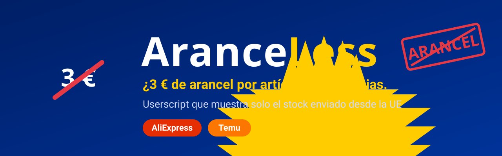

# AranceLess - userscript para tasa 3€ Aliexpress y Temu



[](aranceless.user.js)
[](https://greasyfork.org/es/scripts/602577-aranceless-solo-stock-ue-en-aliexpress-y-temu)
[](https://greasyfork.org/es/scripts/602577-aranceless-solo-stock-ue-en-aliexpress-y-temu)
[](LICENSE)
[](#por-qué-existe)
[](#aliexpress)
[](#temu)
[](https://www.tampermonkey.net/)
[](https://violentmonkey.github.io/)
[](#privacidad)
[](https://github.com/D4vRAM369/aranceless-userscript/stargazers)

> **¿3 € de arancel por cada artículo? No, gracias.**
> AranceLess oculta en AliExpress y Temu todo lo que **no** se envía desde un almacén de la Unión Europea, para que solo veas lo que te llega sin pagar la tasa.

---

## Por qué existe

Desde el **1 de julio de 2026** la UE cobra un arancel fijo de unos **3 € por artículo** en los paquetes de poco valor que llegan de fuera de la UE. Da igual que el producto cueste 1,50 €: pagas 3 € más por cada unidad.

Si el artículo **ya está en un almacén europeo**, no cruza ninguna aduana y **no paga esa tasa**. Las dos plataformas tienen ese stock, pero lo mezclan con el resto y no ponen fácil verlo por separado. AranceLess lo separa por ti.

Esto **no evade nada**: comprar a un almacén de la UE es completamente legal. Solo te ahorra buscar.

## Qué hace

### AliExpress
- Activa el filtro oficial **"Envío desde: Unión Europea"** (`shpf_co=EU`) en cada búsqueda.
- Pone la placa `🇪🇺 Desde la UE · 0 € arancel` en cada producto.
- Oculta los **anuncios**, que se cuelan aunque el filtro esté activo y no garantizan el origen.

### Temu
- Oculta todo lo que no lleva la etiqueta **"Local"** (almacén europeo) y pone la placa a lo que sí.
- **Autocarga:** pulsa «Ver más» por ti, con pausas de 3–4 s, hasta sumar **20 artículos UE** más.
- Botón **`🔎 «tu búsqueda» en Almacén local`**: te lleva a la sección de almacén local de Temu filtrada por tus palabras.

### En las dos
- Insignia azul abajo a la derecha con el estado (`N UE ✓ · M ocultos`). Al pulsarla ves también lo oculto.
- Avisa cuando la página está vacía porque **no hay nada europeo**, o porque **Temu ha bloqueado la carga** con su antibot.

## Instalación

1. Instala un gestor de userscripts:
   - **Firefox:** [Violentmonkey](https://addons.mozilla.org/firefox/addon/violentmonkey/) o [Tampermonkey](https://addons.mozilla.org/firefox/addon/tampermonkey/)
   - **Chrome / Brave / Edge:** [Tampermonkey](https://chromewebstore.google.com/detail/dhdgffkkebhmkfjojejmpbldmpobfkfo)
2. **[👉 Instalar desde Greasy Fork](https://greasyfork.org/es/scripts/602577-aranceless-solo-stock-ue-en-aliexpress-y-temu)** (recomendado) o **[directamente desde GitHub](https://raw.githubusercontent.com/D4vRAM369/aranceless-userscript/main/aranceless.user.js)**: el gestor te ofrecerá instalarlo.
3. **Solo en Chrome, Brave y Edge:** ve a `chrome://extensions` (o `brave://extensions`) → Tampermonkey → **Detalles** y activa **"Permitir scripts de usuario"**.
4. Recarga AliExpress o Temu.

Las actualizaciones llegan solas a través del gestor.

## Limitaciones honestas

- **Temu no tiene filtro de almacén en la búsqueda.** El script solo puede ocultar lo que Temu ya ha cargado, y en muchas búsquedas los artículos "Local" son minoría. La autocarga ayuda con eso.
- **El antibot de Temu** puede bloquear la carga si se navega muy rápido o de forma automatizada. Si aparece `⚠️ Temu bloqueó la carga`, no es el script: espera un rato o completa su verificación.
- **Almacén local de Temu** es un escaparate elegido por Temu, no necesariamente todo su stock europeo.
- **Las webs cambian.** Si Temu o AliExpress cambian sus etiquetas o sus parámetros, el filtro puede dejar de funcionar. [Abre un issue](https://github.com/D4vRAM369/aranceless-userscript/issues).

## Privacidad

`@grant none`: el script **no hace ninguna petición de red**, no recoge datos y no usa permisos especiales. Solo lee la página que ya tienes abierta y oculta o marca tarjetas.

## Desarrollo

```bash
node aranceless.user.js   # autocomprobación: "AranceLess: autocomprobación OK"
```

Toda la historia del proyecto (decisiones, errores reales y cómo se depuraron) está en [`docs/`](docs/README.md), escrita con metodología PBL para quien quiera aprender.

---

## English

**AranceLess** is a userscript for **AliExpress** and **Temu** that hides every product **not shipped from an EU warehouse**, so you skip the ~€3-per-item EU customs duty on low-value parcels from outside the EU (in force since 1 July 2026).

- **AliExpress:** forces the official "Ship from: European Union" filter, tags each product and hides ads.
- **Temu:** keeps only items with the green "Local" label, auto-loads more results at a human pace (3–4 s) and adds a shortcut to search inside Temu's Local Warehouse.
- **Install:** from [Greasy Fork](https://greasyfork.org/en/scripts/602577-aranceless-solo-stock-ue-en-aliexpress-y-temu) or [straight from GitHub](https://raw.githubusercontent.com/D4vRAM369/aranceless-userscript/main/aranceless.user.js), with Tampermonkey or Violentmonkey installed. On Chromium browsers, enable **"Allow user scripts"** in the extension details.
- No network requests, no tracking (`@grant none`).

---

**Autor:** [D4vRAM369](https://github.com/D4vRAM369) · **Licencia:** [MIT](LICENSE)
